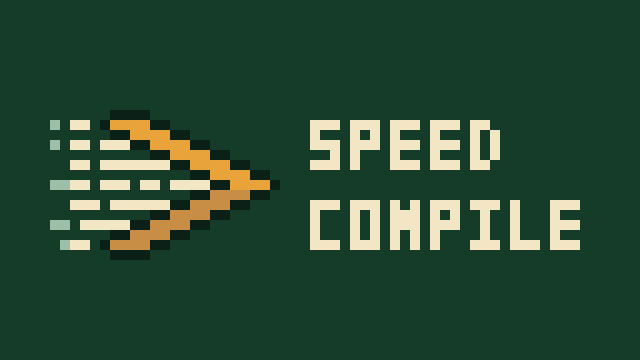
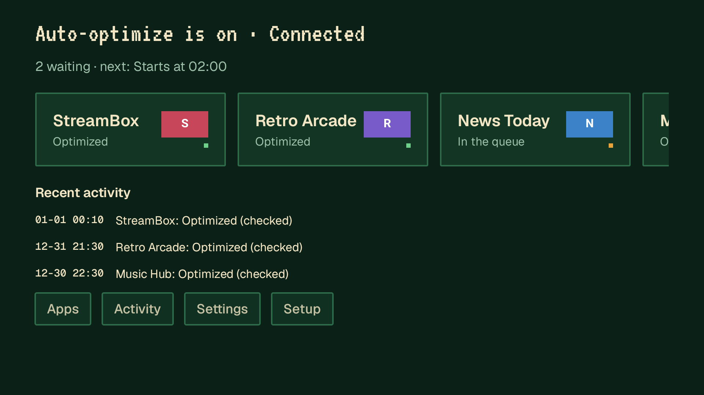
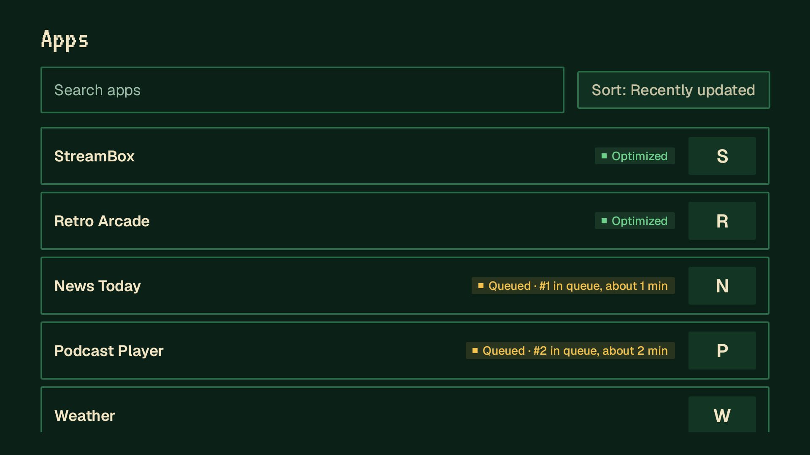
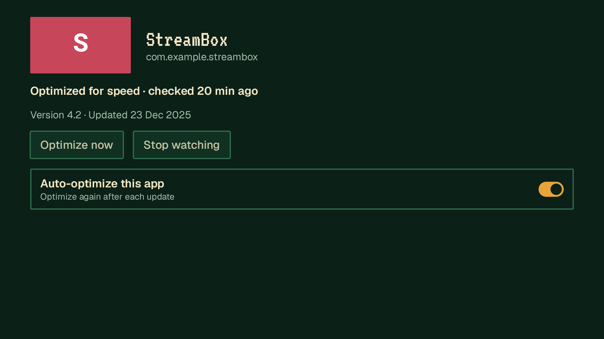
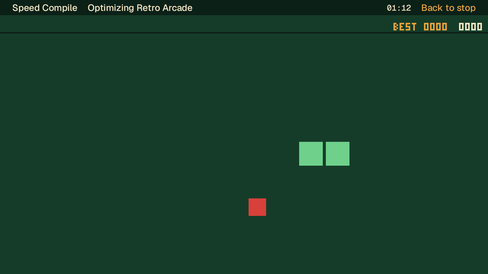
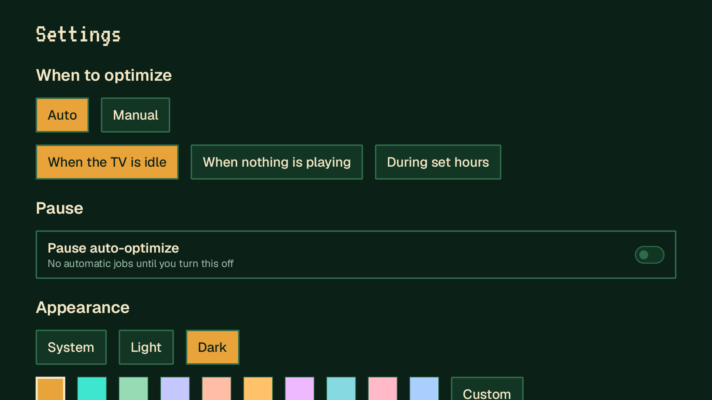

<p align="center">
  
</p>

<h1 align="center">Speed Compile</h1>

<p align="center">Compiles the Android TV apps you pick ahead of time, and again after each update.</p>

<p align="center">
  <a href="https://github.com/k45sle/android-tv-speed-compiler/actions/workflows/ci.yml"></a>
  
  <a href="LICENSE"></a>
</p>

> [!IMPORTANT]
> **This app was written entirely by AI.** All of its code, tests and documentation were written by Claude (Anthropic's AI) in Claude Code, and the original logo art was made with Google Gemini. I am not a programmer. What I did:
>
> - Came up with the idea, mostly so Nuvio and apps like it would run better on my TV.
> - Decided to drop the first version, a Docker service you ran on a computer, in favour of an app that runs on the TV itself.
> - Approved the screen designs before any of them were built.
> - Turned down "TV Speed" for sounding like a scam, and picked the name.
> - Made the logo, then rejected four fonts and one embossing experiment for the banner until it had no text left on it.
> - Asked for a retro pixel-art look, then picked the pixel logo and the banner with its pixel wordmark from Claude's candidates.
> - Set a budget of under $1 for the whole project and held Claude to it.
> - Reviewed the work and pushed back on anything that looked like AI slop.

<!-- Placeholder until the demo video is recorded. -->
<p align="center">
  
</p>

<p align="center">
  <picture>
    <source media="(prefers-color-scheme: light)" srcset="docs/media/home-light.png">
    
  </picture>
</p>

<table align="center">
  <tr>
    <td><picture><source media="(prefers-color-scheme: light)" srcset="docs/media/apps-light.png"></picture></td>
    <td></td>
  </tr>
  <tr>
    <td></td>
    <td></td>
  </tr>
</table>

<p align="center"><sub>Screenshots use made-up demo apps.</sub></p>

## About this app

Android normally compiles an app bit by bit, based on how you use it. Speed Compile asks the TV to compile the apps you choose fully, using Android's `speed` profile, and does it again whenever one of them updates. It talks to the TV through the TV's own Wireless debugging, so it needs no computer once it is set up.

Results vary by app and by TV. Some apps open or scroll more smoothly; some show no difference. Each compiled app takes a bit more storage.

The app was written with the Nuvio community in mind, but it works with any app on the TV.

## What it does

- Watches the apps you pick and queues a compile when one of them updates.
- Waits until nothing is playing, or until a time window you set, so it does not slow down what you are watching.
- Reconnects by itself after the TV restarts, as long as Wireless debugging stays on.
- Lets you play Snake, a runner or a flappy game while a compile runs.
- Shows a history of each job, with the reason when one fails.
- Has eight accent colours plus a custom one, and light and dark themes.

## Data safety

- No account, no ads, no analytics.
- The app connects only to the TV it runs on, and to your phone on the same network when you pair or download diagnostics. Nothing is sent anywhere else unless you share a diagnostics file yourself.
- The debugging key is created on the TV and stays in the app's private storage.
- A diagnostics export holds settings, the queue, recent events and the package names of the apps involved. Addresses, codes, serial numbers and device names are removed before it is written.

## Install

1. Download the APK from [Releases](https://github.com/k45sle/android-tv-speed-compiler/releases) onto the TV, for example with the Downloader app, or send it from your phone with Send Files to TV.
2. Open the APK on the TV and allow installs from that source if asked.
3. Open Speed Compile and follow the setup. It walks you through Developer options and Wireless debugging, then shows a QR code: scan it with your phone and type the 6-digit pairing code from the TV.

## Setup help

If setup gets stuck, these are the usual causes.

| What you see | What to do |
| --- | --- |
| No Developer options in Settings | Open Settings, then System, then About. Press OK on Build 7 times. |
| The pairing code did not work | Codes expire after a short time. Open Pair device with pairing code again on the TV and type the new 6 digits. |
| The phone can't open the pairing page | Keep the phone on the same Wi-Fi as the TV. If the QR code will not scan, type the short address shown on the TV into the phone's browser. |
| The TV asks to allow debugging | Choose Always allow from this computer, then OK. |
| Wireless debugging is off | It can switch off after a network change. Turn it on again in Developer options and the app reconnects by itself. |
| The TV forgot this app | Open the app and choose Pair again. |

Inside the app, Help lists the same fixes, and Settings > Export diagnostics makes a file you can attach to an issue.

## Compatibility

Speed Compile needs Android TV or Google TV 11 or later, because Wireless debugging arrived in Android 11.

So far it has been tested on the Android TV emulator (API 34) only. Reports from real TVs and streaming boxes are welcome in [Issues](https://github.com/k45sle/android-tv-speed-compiler/issues).

## FAQ

**Will it make my TV faster?**
It can make the apps you pick start or run more smoothly. It does not touch system apps or the TV's software, and some apps show no difference.

**Why does it need Developer options?**
Only the debugging connection can ask Android to compile another app. Speed Compile connects to Wireless debugging on the TV itself. Through that connection it also gives itself permission to switch Wireless debugging back on after a restart, and, if you turn on Keep this TV trusting the app, stops the TV from asking to allow debugging again.

**Is it safe?**
It runs Android's own compiler through the standard `cmd package compile` command, only for the apps you pick. You can stop it at any time by switching off Wireless debugging or uninstalling the app. Wireless debugging and the trust setting stay as they are after an uninstall; switch them off in Developer options if you no longer want them.

## Build from source

```bash
./gradlew assembleDebug
```

The APK lands in `app/build/outputs/apk/debug/`. You need JDK 17 and the Android SDK.

## License

[MIT](LICENSE). The bundled Geist and VT323 fonts are under the SIL Open Font License ([Geist](third_party/GEIST-OFL.txt), [VT323](third_party/VT323-OFL.txt)). The Alien Run character, hearts and some game tiles are adapted from [Kenney's Pixel Platformer](third_party/KENNEY-CC0.txt) (CC0).
