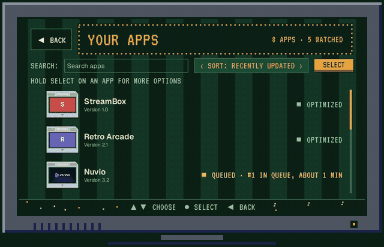
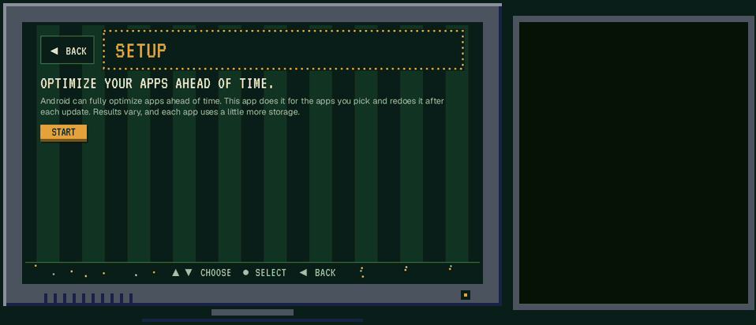
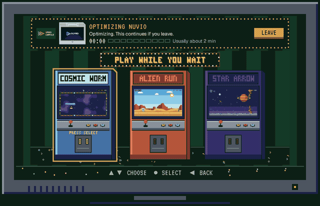
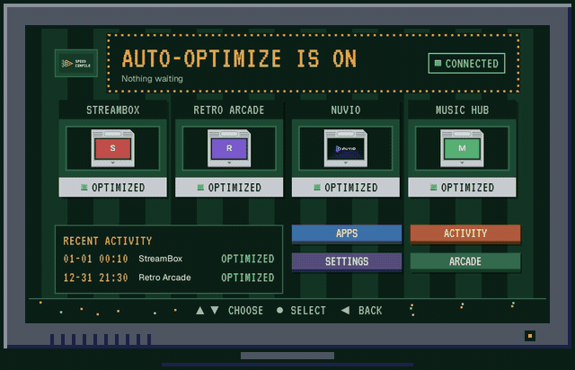
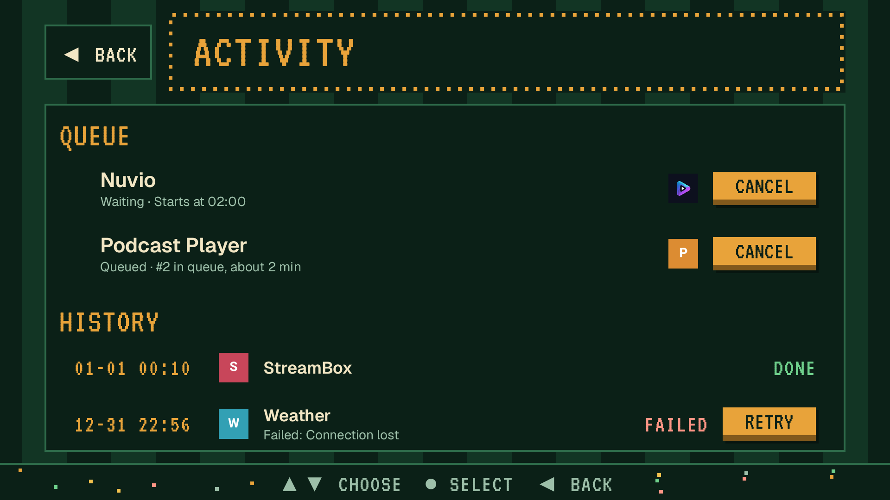
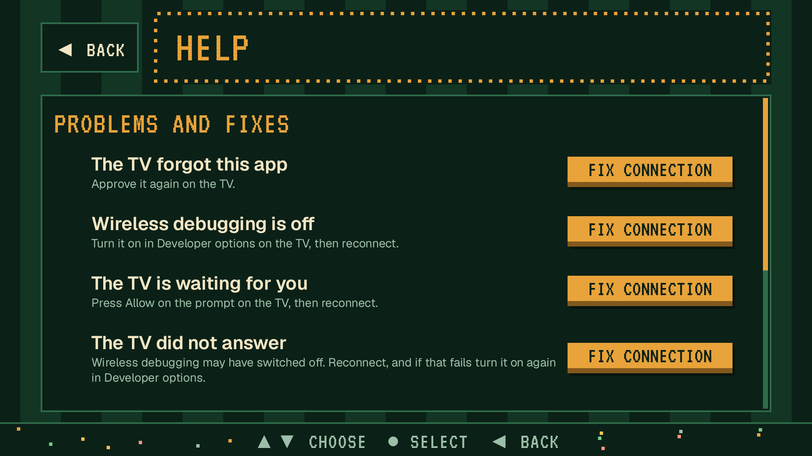
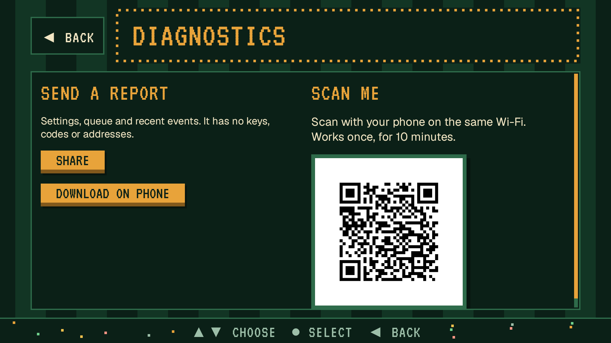
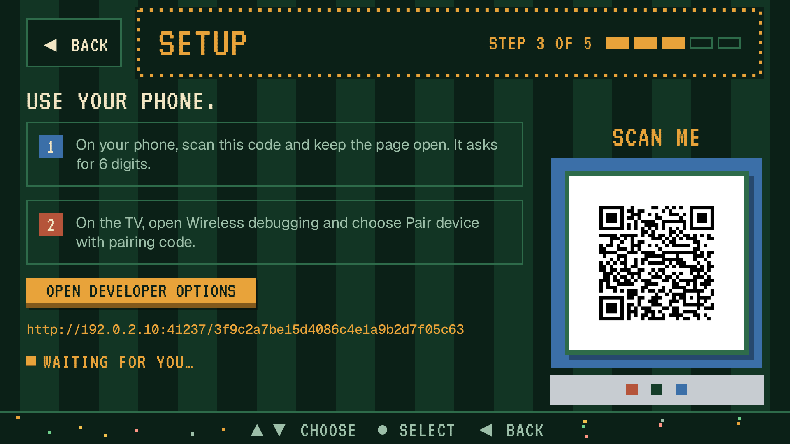
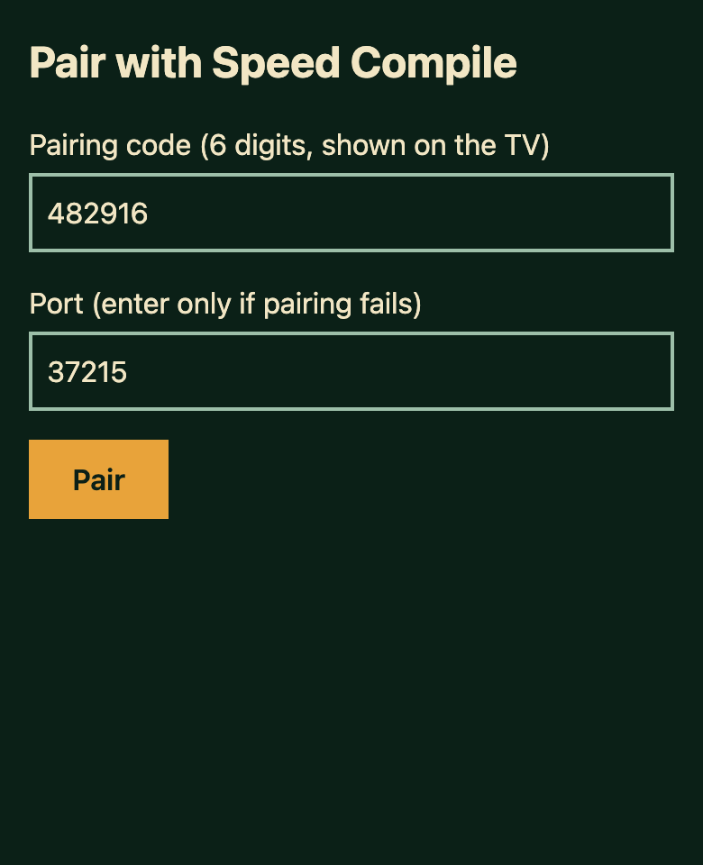
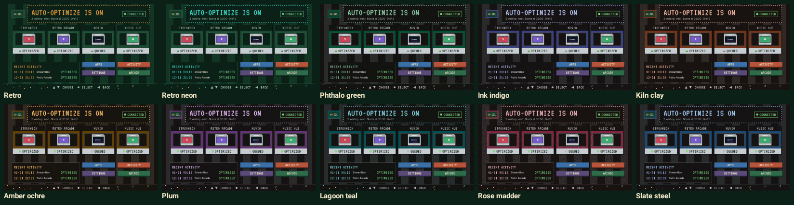

<p align="center">
  
</p>

<h1 align="center">Speed Compile</h1>

<p align="center">Compiles the Android TV apps you pick ahead of time, and again after each update. It runs on the TV, so you don't need a computer.</p>

<p align="center">
  <a href="https://github.com/k45sle/android-tv-speed-compiler/releases"></a>
  <a href="https://github.com/k45sle/android-tv-speed-compiler/actions/workflows/ci.yml"></a>
  
  <a href="LICENSE"></a>
</p>

<p align="center">
  <a href="https://github.com/k45sle/android-tv-speed-compiler/releases"><b>Download the APK</b></a>
  &nbsp;·&nbsp;
  <a href="https://apps.obtainium.imranr.dev/redirect?r=obtainium://add/https://github.com/k45sle/android-tv-speed-compiler">Add to Obtainium</a>
</p>

<p align="center">
  <picture>
    <source media="(prefers-reduced-motion: reduce)" srcset="docs/media/hero.png">
    
  </picture>
  <br>
  <sub>Pick an app, press Optimize now, and it is done in about a minute. <a href="docs/media/demo.mp4">Watch the full demo (MP4)</a>.</sub>
</p>

Android normally compiles an app a bit at a time, based on how you use it. Speed Compile asks the TV to compile the apps you choose ahead of time, with Android's `speed-profile` filter (it falls back to `speed`, see below), and does it again whenever one of them updates. It talks to the TV through the TV's own Wireless debugging.

Results vary by app and by TV. Some apps open or scroll more smoothly, and some show no difference. Each compiled app takes up a bit more storage.

It was written with Nuvio in mind (people who sideload the GitHub build run `pm compile` by hand after every update), but it works with any app on the TV.

## How it goes

<table>
  <tr>
    <td width="50%" valign="top">
      <picture>
        <source media="(prefers-reduced-motion: reduce)" srcset="docs/media/setup.png">
        
      </picture>
      <b>Set it up once.</b> Turn on Wireless debugging, scan the QR code with your phone and type the pairing code.
    </td>
    <td width="50%" valign="top">
      <picture>
        <source media="(prefers-reduced-motion: reduce)" srcset="docs/media/hero.png">
        
      </picture>
      <b>Pick your apps.</b> Choose the ones that feel slow. Speed Compile watches them from then on.
    </td>
  </tr>
  <tr>
    <td width="50%" valign="top">
      <picture>
        <source media="(prefers-reduced-motion: reduce)" srcset="docs/media/arcade.png">
        
      </picture>
      <b>Play while you wait.</b> A compile can take a few minutes, so there are three small games.
    </td>
    <td width="50%" valign="top">
      <picture>
        <source media="(prefers-reduced-motion: reduce)" srcset="docs/media/handsoff.png">
        
      </picture>
      <b>Then forget about it.</b> After an update it waits until nothing is playing, compiles the app again and reconnects by itself after a restart.
    </td>
  </tr>
</table>

## Screenshots

<table>
  <tr>
    <td width="50%"><picture><source media="(prefers-color-scheme: light)" srcset="docs/media/home-light.png"></picture><br><sub>Home: what's connected, what's waiting, what's done.</sub></td>
    <td width="50%"><picture><source media="(prefers-color-scheme: light)" srcset="docs/media/apps-light.png"></picture><br><sub>Apps: search and pick what to watch.</sub></td>
  </tr>
  <tr>
    <td><picture><source media="(prefers-color-scheme: light)" srcset="docs/media/appdetail-light.png"></picture><br><sub>App detail: optimize now, reset, or stop watching.</sub></td>
    <td><picture><source media="(prefers-color-scheme: light)" srcset="docs/media/activity-light.png"></picture><br><sub>Activity: the queue and every finished job, with the reason when one fails.</sub></td>
  </tr>
  <tr>
    <td><br><sub>Help: the usual setup problems and their fixes.</sub></td>
    <td><br><sub>Diagnostics: send a cleaned-up log file to your phone.</sub></td>
  </tr>
  <tr>
    <td><br><sub>Quick re-pair: if the TV forgets the app, pairing again takes one scan.</sub></td>
    <td><br><sub>The pairing page as your phone shows it.</sub></td>
  </tr>
</table>

<p align="center">
  
  <br>
  <sub>Eight accent colours plus a custom one, in light or dark.</sub>
</p>

<p align="center"><sub>The Nuvio name and logo belong to the Nuvio project (GPL-3.0, <a href="https://github.com/NuvioMedia/NuvioTV">github.com/NuvioMedia/NuvioTV</a>) and the art is used only by the screenshot tests. Other apps in the screenshots are made up.</sub></p>

> [!NOTE]
> **Written by AI.** All the code, tests and docs were written by Claude (Anthropic's AI) in Claude Code, and the first logo art came from Google Gemini. I'm not a programmer. I had the idea, chose to build an app on the TV instead of a Docker service on a computer, approved every screen design before it was built, picked the name and the pixel look, kept the whole project under $1, and pushed back on anything that looked like AI slop.

## Does it help?

Measured on one Android 14 TV box (4x Cortex-A55, 3.5 GB RAM). Cold start is the median of 5 launches, before any compile (`verify`) and after each filter.

| App | `verify` | `speed-profile` (default) | `speed` |
| --- | --- | --- | --- |
| Nuvio | 2.07 s | 1.12 s | 1.45 s |
| SmartTube | 0.80 s | 0.63 s | 0.80 s |
| Jellyfin | 0.86 s | 0.72 s | 0.74 s |
| VLC | 0.75 s | 0.64 s | 0.71 s |
| Just Player | 0.57 s | 0.49 s | 0.58 s |
| Aerial Views | 0.31 s | 0.27 s | 0.32 s |

`speed-profile` started fastest in every app. Compared with `speed` it used half the storage or less (Nuvio 57 MB against 127 MB, SmartTube 31 MB against 82 MB, Jellyfin 56 MB against 120 MB) and compiled several times faster (Nuvio 22 s against 86 s, SmartTube 5 s against 37 s, Aerial Views 6 s against 17 s). While scrolling Nuvio's home rows, 58-68% of frames were janky at `verify`, 31-34% at `speed-profile` and 28-30% at `speed`.

`speed-profile` compiles the parts of an app you actually use, so it needs a usage profile. Many apps ship one, and Speed Compile asks the app to load it before compiling, so those apps are ready right after an update. Over the next week it quietly refreshes them, whenever the TV goes idle (at most every 30 minutes), so the compiled code follows how you use the app. Apps that ship no profile have to build one: Android empties it on every update, and the app builds a new one while you use it. Speed Compile then waits for you to use the app for about a minute, tries again every hour, and compiles everything with `speed` after 2 days if the app still has no profile (it keeps waiting while the TV has less than 1 GB of free storage). App detail has an Open button for that wait. In Settings, under Advanced, "How to optimize" can be switched to Full compile, which compiles `speed` for every app: ready right after an update, about twice the storage, slightly slower start. Android never compiles debug builds of apps ahead of time, so Speed Compile skips those and says so.

These numbers come from one TV. Other TVs and apps will differ.

## What it does

- Watches the apps you pick and queues a compile when one of them updates.
- Waits until nothing is playing, or for a time window you set, so it doesn't slow down what you're watching.
- Checks once a week, and right after a system update, that each watched app is still compiled, and compiles it again if not.
- Reconnects by itself after the TV restarts, when you open the app, or when a job loses its connection, and turns Wireless debugging back on at those moments (you can turn this off in Settings).
- Lets you play Alien Run, Star Arrow or Cosmic Worm while a compile runs.
- Keeps a history of each job, with the reason when one fails.

## Data safety

- No account, no ads, no analytics.
- The app connects only to the TV it runs on, and to your phone on the same network when you pair or download diagnostics. Nothing is sent anywhere else unless you share a diagnostics file yourself.
- The debugging key is created on the TV and stays in the app's private storage.
- A diagnostics export holds settings, the queue, recent events and the package names of the apps involved. Addresses, codes, serial numbers and device names are removed before it is written.
- The phone pairing page uses plain HTTP on your local network, so someone on the same Wi-Fi could in theory read the 6-digit code while you type it. The code works only for a short time. Pair on a network you trust.

### Checking a download

Releases after v0.9.0-test1 have a `SHA256SUMS` file and a build provenance attestation from GitHub Actions, and its release notes list the SHA-256 fingerprint of the signing certificate.

```bash
sha256sum -c SHA256SUMS --ignore-missing
```

```bash
gh attestation verify speed-compile.apk --repo k45sle/android-tv-speed-compiler
```

To compare the signing certificate with the one in the release notes:

```bash
apksigner verify --print-certs speed-compile.apk
```

## Install

1. Get the APK onto the TV. Download it from the [Releases page](https://github.com/k45sle/android-tv-speed-compiler/releases). From the first full release on, the stable link `https://github.com/k45sle/android-tv-speed-compiler/releases/latest/download/speed-compile.apk` always points to the newest APK, which is handy to type into the Downloader app. You can also send the file from your phone with Send Files to TV, or add the repo to [Obtainium](https://apps.obtainium.imranr.dev/redirect?r=obtainium://add/https://github.com/k45sle/android-tv-speed-compiler) for updates.
2. Open the APK on the TV and allow installs from that source if asked.
3. Open Speed Compile and follow the setup. It walks you through Developer options and Wireless debugging, then shows a QR code. Scan it with your phone and type the 6-digit pairing code from the TV.

<details>
<summary><b>Setup help</b></summary>

<br>

If setup gets stuck, these are the usual causes.

| What you see | What to do |
| --- | --- |
| No Developer options in Settings | Open Settings, then System, then About. Press OK on Build 7 times. |
| The pairing code did not work | Codes expire after a short time. Open Pair device with pairing code again on the TV and type the new 6 digits. |
| The phone can't open the pairing page | Keep the phone on the same Wi-Fi as the TV. If the QR code will not scan, type the short address shown on the TV into the phone's browser. |
| The TV asks to allow debugging | Choose Always allow from this computer, then OK. If you turned off Keep this TV trusting the app in Settings, Android can ask again after a while. |
| Wireless debugging is off | It can switch off after a network change. With Keep Wireless debugging on (the default), the app turns it back on as soon as you open it, after the TV restarts, or when an optimization or weekly check loses its connection. If you turned that setting off, turn Wireless debugging on again in Developer options and the app reconnects by itself. |
| The TV forgot this app | Open the app and choose Fix connection. |

Inside the app, Help lists the same fixes, and Settings > Export diagnostics makes a file you can attach to an issue.

</details>

## Compatibility

Speed Compile needs Android TV or Google TV 11 or later, because Wireless debugging arrived in Android 11.

| Device | Android | Worked? |
| --- | --- | --- |
| Android TV emulator | 14 (API 34) | Yes |
| Fire TV | Fire OS 8 | Untested |

If you try it on a real TV or streaming box, please fill in the [Device report form](https://github.com/k45sle/android-tv-speed-compiler/issues/new?template=device-report.yml), whether it worked or not.

<details>
<summary><b>FAQ</b></summary>

<br>

**Will it make my TV faster?**
It can make the apps you pick start or run more smoothly. It does not touch system apps or the TV's software, and some apps show no difference.

**What exactly does it change on the TV?**
For each app you pick, it runs `cmd package compile -m speed-profile -f` on that app (or `-m speed` when the app still has no usage profile a week after an install or update). Through the same connection it changes two settings so it keeps working on its own: it turns Wireless debugging back on when it finds it off, and it stops Android from forgetting that you allowed debugging. Nothing else.

**Why does it need Developer options?**
Only the debugging connection can ask Android to compile another app. Speed Compile connects to Wireless debugging on the TV itself. The two settings above are on by default:

- Keep Wireless debugging on: each time the app reconnects (after a restart, when you open the app, or when an optimization or weekly check loses its connection), it turns Wireless debugging back on if it is off, even if you switched it off yourself.
- Keep this TV trusting the app: Android normally forgets that you allowed debugging after a while. This stops it from forgetting, so the TV doesn't ask again.

You can turn either one off in the app's Settings, but things get less convenient. With Keep Wireless debugging on off, optimizing stops each time Wireless debugging goes off, until you turn it back on in Developer options. With Keep this TV trusting the app off, the TV may ask you to allow debugging again, and nothing gets optimized until you do.

**Does a system update undo it?**
It can. A system update may throw away compiled code. When the TV starts up after an update, Speed Compile sees the new system version and checks every watched app right away, and queues any that are no longer at `speed-profile` or `speed`. The weekly check catches anything that slips through. App updates are a separate case: Speed Compile looks for them every 30 minutes and after each restart, and queues an updated app as soon as it finds one. The system update case hasn't been checked on a real TV yet.

**Does it work on Ethernet?**
Unknown so far. Android's Wireless debugging is built around Wi-Fi, so some TVs may not turn it on over Ethernet. If you try it on Ethernet, say so under What went wrong? in the Device report form.

**How is this different from running `pm compile` myself, or from other ADB tools?**
The compile is the same. The difference is that Speed Compile runs on the TV, does it again after every update without a laptop, waits until nothing is playing, and reconnects after reboots.

**Is it safe?**
It runs Android's own compiler through the standard `cmd package compile` command, only for the apps you pick. You can stop it at any time by uninstalling the app, or by turning off Keep Wireless debugging on in Settings and then switching off Wireless debugging. Wireless debugging and the trust setting stay as they are after an uninstall; switch them off in Developer options if you no longer want them.

**How do I undo it?**
Open the app in Apps and choose Reset. The app also stops being watched. Uninstalling Speed Compile does not undo it.

</details>

<details>
<summary><b>Build from source</b></summary>

<br>

```bash
./gradlew assembleDebug
```

The debug APK lands in `app/build/outputs/apk/debug/`. You need JDK 17, the Android SDK and network access on the first build, because one dependency (libadb-android) comes from JitPack.

To run the same checks as CI on every pull request (lint, the unit tests and the debug build):

```bash
./gradlew lint testDebugUnitTest assembleDebug
```

Release builds are signed only when `releaseStoreFile`, `releaseStorePassword` and `releaseKeyAlias` are set in `~/.gradle/gradle.properties`. Without them the release APK is unsigned.

The README screenshots and clips are Robolectric tests that run only with `-Pmedia`. To record the screenshots again:

```bash
README_SHOTS_DIR=$PWD/docs/media ./gradlew cleanTestDebugUnitTest testDebugUnitTest --tests '*ReadmeScreenshotsTest' -Pmedia -Proborazzi.record
```

`tools/demo.sh` records the README clips and writes their GIFs and posters into `docs/media`, and the MP4s outside the repo. See the script for how to attach the MP4s to a release.

</details>

## Planned

- Smarter advice from startup smoothness: score the first minutes after launch on their own, where compiling helps most.
- More languages. The app is in English only for now.

What changed in each version is in the [changelog](CHANGELOG.md).

## License

[MIT](LICENSE). The bundled Geist and VT323 fonts are under the SIL Open Font License ([Geist](third_party/GEIST-OFL.txt), [VT323](third_party/VT323-OFL.txt)). The Alien Run character, hearts and some game tiles are adapted from [Kenney's Pixel Platformer](third_party/KENNEY-CC0.txt) (CC0). The Nuvio art in the screenshots is Nuvio's own, under GPL-3.0 ([its notice](app/src/test/resources/nuvio/NOTICE)). Only the screenshot tests use it, and it is not part of the app.
